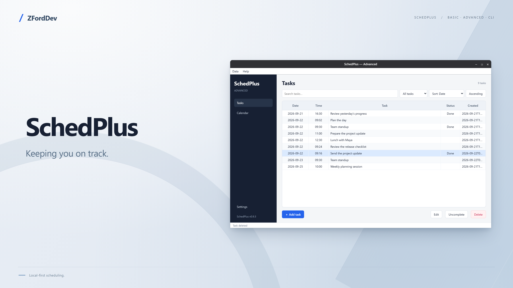
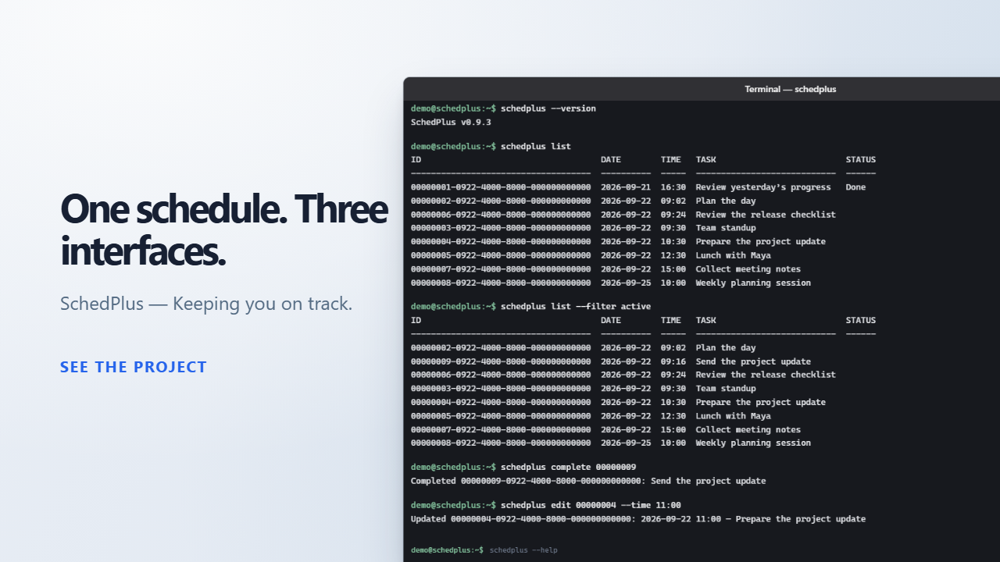
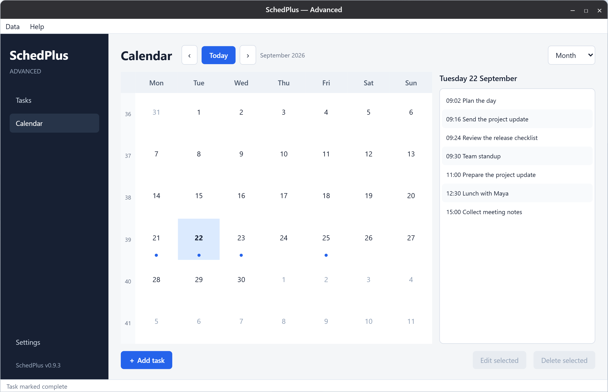
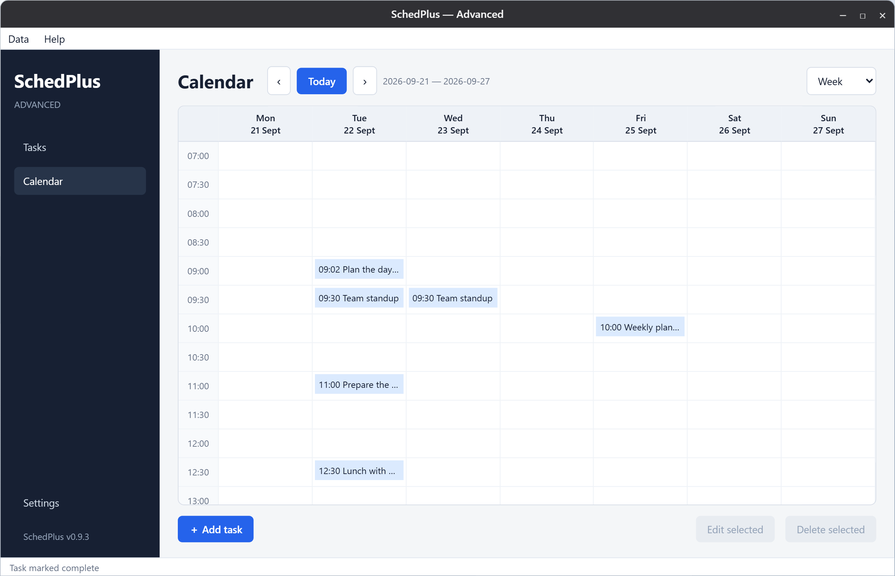
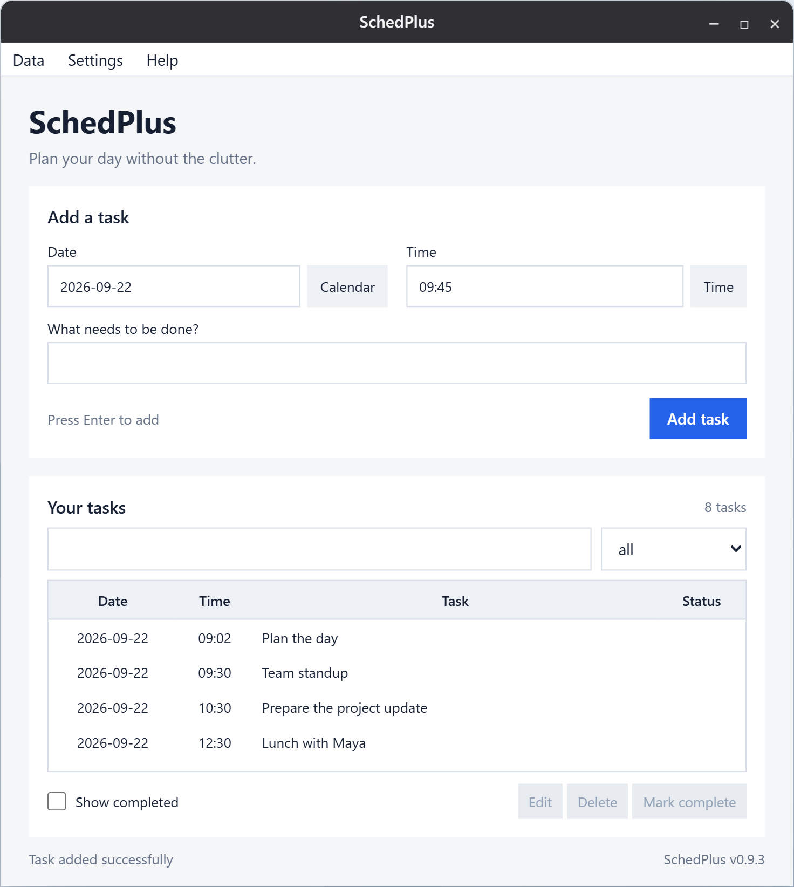
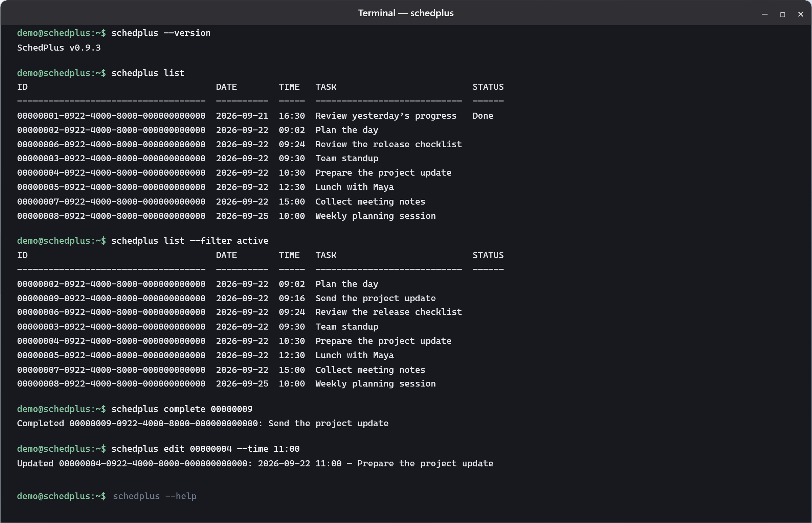

<div align="center">

# SchedPlus

## 🌟 Keeping you on track 🌟

[Website](https://schedplus.app/) · [Documentation](https://docs.zford.dev/docs/ZFordDev/SchedPlus/) · [Downloads](https://schedplus.app/downloads/) · [Report a bug](https://github.com/ZFordDev/SchedPlus/issues/new/choose)

[](https://github.com/ZFordDev/SchedPlus)

[](https://github.com/ZFordDev/SchedPlus/releases)
[](LICENSE)
[](LICENSES/Apache-2.0.txt)

</div>

SchedPlus is a local-first task planner built around one simple idea: **your schedule should stay yours, no matter how you choose to work with it.**

Keep things simple with **Basic**, dig deeper with filters and calendar views in **Advanced**, or jump into the **CLI** when typing a command is faster.

All three interfaces share the same task store. No separate schedules, no copying tasks between interfaces. Just different ways to work with the same plan.

## See SchedPlus at work

<p align="center">
  
  
</p>

<p align="center">
  <a href="https://www.youtube.com/watch?v=cBp9AbrHUe8">
    
  </a>
  <br>
  <sub>▶️ <i>See SchedPlus at work</i></sub>
</p>

<p align="center">
  
  
  
  
</p>

## What can it do?

Quite a bit, actually!

- **Calendar views**: Plan your day, week, or month.
- **Task management**: Create, edit, organise, and complete tasks.
- **Recurring tasks**: Daily, weekly, monthly, or yearly.
- **Reminders**: Native notifications without needing an internet connection.
- **Three interfaces**: Advanced, Basic, and CLI.
- **Local storage**: Your tasks stay on your device.
- **Backups**: Export, import, and restore your task data.
- **Personalisation**: Adjust date formats, accessibility options, and more.

## Choose your edition

| Edition | Best for |
|---|---|
| **Standard** | The full Advanced desktop experience |
| **Lite** | A lightweight, straightforward task planner |
| **Full** | Both desktop interfaces in one package |
| **CLI** | Terminal users and automation |

SchedPlus is available for **Windows and Linux**, with installers and portable options depending on your platform.

Grab the latest version from [GitHub Releases](https://github.com/ZFordDev/SchedPlus/releases).

For installation instructions and package details, visit the [documentation](https://docs.zford.dev/docs/ZFordDev/SchedPlus/).

## Build from source

You'll need Python 3.10 or newer.

```bash
git clone https://github.com/ZFordDev/SchedPlus.git
cd SchedPlus
python -m venv .venv
source .venv/bin/activate
pip install -e ".[full]"
schedplus
```

## Prefer the terminal?

SchedPlus has a CLI too!

```bash
schedplus add "Buy milk" --date 2027-01-20 --time 14:00
schedplus list
schedplus backup SchedPlus-backup.json
schedplus export SchedPlus-tasks.json
```

Run `schedplus --help` to explore the available commands.

## Your data stays yours

SchedPlus is designed to work offline.

Your tasks, preferences, and backups are stored locally. No accounts or cloud synchronisation are required.

Some versions can check GitHub for updates, while Store installations use their respective update services.

Your task data isn't uploaded as part of these operations.

For more information, see [PRIVACY.md](PRIVACY.md).

## Contributing

Found a bug? Have an idea? Want to help improve SchedPlus?

Contributions are welcome!

Check out [CONTRIBUTING.md](CONTRIBUTING.md) or open an [issue](https://github.com/ZFordDev/SchedPlus/issues).

For security concerns, please see [SECURITY.md](SECURITY.md).

## License

- **Desktop application:** [GPL-3.0-only](LICENSE)
- **Reusable core modules:** [Apache License 2.0](LICENSES/Apache-2.0.txt)

See [NOTICE](NOTICE) for licensing details and attribution.
